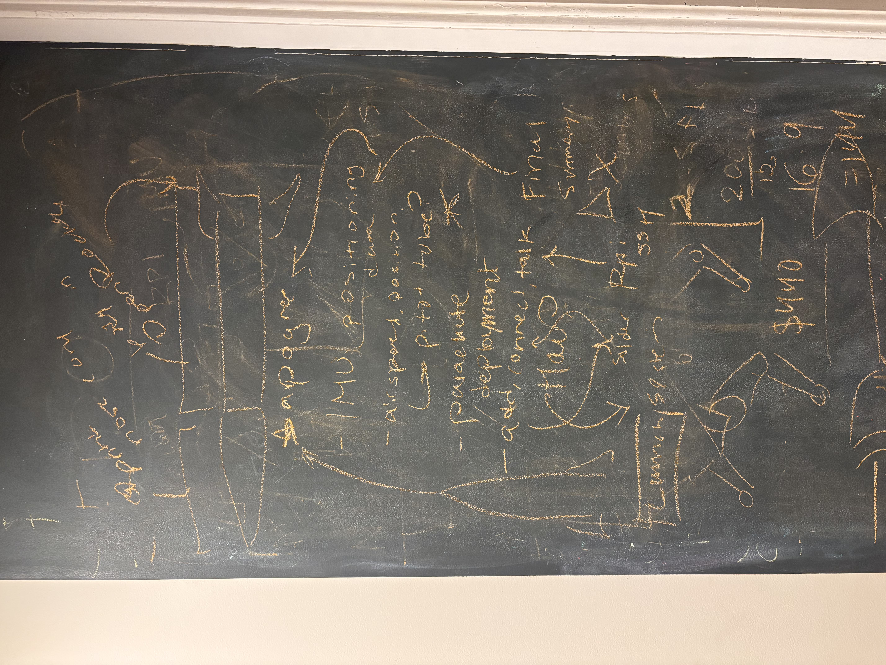

# **October 12:** Planning

Researched PCB flaws and tips, found inspo and design references, and safety protocols.

## Helpful Links

- https://github.com/The-Faulty/Lyra
- https://magazine.raspberrypi.com/articles/starlight-model-rocket-flight-computer-vs-rockit-flight-computer
- https://altusmetrum.org/EasyMini/
- https://nar.org/ModelRocketSafetyCode 
- https://www.nakka-rocketry.net/alti.html
- The Forge flight controller tutorial!!

Created Slack pitch in #forgery and organized all subprojects on forge hub.

I decided that the flight controller will be built in versions for scalability. V1 follows the Forge flight controller tutorial as closely as possible: an active flight controller that logs flight data and drives servos for fins or TVC. The motor's ejection charge deploys the parachute.

PCB V1 requirements:

- Log altitude and motion data to microSD (kept when powered off)
- Control servos for fins or TVC
- Run from a 2S LiPo, with servo power kept separate from logic power
- Charge the battery from USB-C

V2 will add a pyro channel for parachute deployment, LoRa telemetry with a ground station, GPS, a buzzer, and a pitot tube for airspeed.

| Component | Chip/module | Connects to MCU by | Function |
| --------- | ----------- | ------------------ | -------- |
| Microcontroller | STM32F722RET6 (bare chip) | — | Runs flight software |
| USB | USB-C connector | USB | Programming, data download, charging |
| Barometer | BMP580 | I2C or SPI | Altitude |
| IMU | ICM-45686 | SPI | Acceleration and rotation |
| Logging | microSD card socket | SPI or SDIO | Stores every reading |
| Charger | BQ25883 | I2C | Charges the 2S battery from USB-C |
| Servo power | TPS63070 buck-boost, 5 V | Servo rail only | Powers the servos |
| Logic power | LMR51430 buck, 3.3 V | 3.3 V rail | Powers MCU and sensors |
| Status LED | LED + resistor | GPIO | Shows the board is alive |

Plus supporting parts added during the schematic: crystal, decoupling capacitors, reset/BOOT0, SWD header, servo headers, and the 2S battery connector.

## Next steps

- Figure out where and how to fly an actively controlled rocket
- Update pitch (servos, 2S battery, STM32)
- Check that every chip is in stock on LCSC (STM32F722RET6, C118207, was low)
- List every part's LCSC ID and import them with the tutorial's easyeda2kicad script
- Firmware in C (STM32CubeIDE)

**Total time spent: 4 hours**
